# System Architecture

## Architecture principle

The platform separates evidence ingestion, canonical resolution, case orchestration, decision support, and human accountability.

```mermaid
flowchart LR
    subgraph Sources
        ERP[ERP / Product Master]
        Sentinel[Sentinel Alerts]
        LIMS[LIMS / Stability]
        Docs[Document Repository]
        Contracts[Carrier Contracts]
        SOP[SOP / Docuvault]
    end

    subgraph Ingestion
        Adapters[Source Adapters]
        Raw[Raw Event Store]
        Normalize[Normalization Service]
    end

    subgraph Core
        Identity[Identity Resolution]
        Temporal[Temporal Reference Service]
        CaseService[Case Service]
        Evidence[Evidence Service]
        Clock[Regulatory Clock Service]
    end

    subgraph Decision
        Rules[Deterministic Rules]
        Assistant[LLM Recommendation Assistant]
        Guardrails[Policy / Guardrails]
    end

    subgraph Human
        Workbench[Reviewer Workbench]
        Audit[Immutable Audit Log]
    end

    Sources --> Adapters --> Raw --> Normalize --> Identity
    Identity --> Temporal --> CaseService
    Normalize --> Evidence --> CaseService
    CaseService --> Clock
    CaseService --> Rules --> Assistant --> Guardrails --> Workbench
    Workbench --> Audit
    CaseService --> Audit
```

## Components and boundaries

| Component | Responsibility | Why separate |
|---|---|---|
| Source adapters | Connect to ERP, Sentinel, LIMS, documents, contracts, SOP systems | Different schemas, availability, and failure modes |
| Raw event store | Retain immutable original payloads | Enables replay, audit, and correction |
| Normalization service | Standardize timestamps, units, identifiers, and semantics | Prevents downstream inheritance of source inconsistencies |
| Identity resolution | Resolve products, facilities, documents, and studies | Physical entities recur under different labels |
| Temporal reference service | Resolve entities as at a given time | Specifications and documents change over time |
| Case service | Owns case identity, lifecycle, waits, and state transitions | Cases are long-lived and must survive failures and reopens |
| Evidence service | Links events, documents, extracts, and observations | Evidence must remain traceable |
| Regulatory clock service | Calculates notification windows and breach risk | Compliance-critical and isolated from workflow logic |
| Deterministic rules | Apply explicit, testable business and compliance rules | Predictable behavior and clear ownership |
| LLM assistant | Drafts evidence summary and rationale | Reduces preparation effort under constraints |
| Policy guardrails | Validate recommendations and required evidence | Prevents unsafe automation |
| Reviewer workbench | Presents case, evidence, gaps, recommendation, approval controls | Human judgment remains central |
| Audit log | Records material state changes and decisions | Regulatory defensibility |

## Data flow

1. Sentinel excursion alert creates or updates an event.
2. Adapter preserves raw payload and emits normalized event.
3. Identity resolution maps references to canonical entities.
4. Temporal service resolves applicable specification, SOP, contract, and stability evidence.
5. Case service creates or updates a case and links evidence.
6. Regulatory clock service calculates notification status from alert timestamp.
7. Deterministic rules produce classification and required-evidence checklist.
8. LLM drafts evidence summary and rationale, constrained by guardrails.
9. Reviewer reviews, requests more information if needed, overrides, and signs disposition.
10. Every transition, recommendation, override, and approval is audited.
