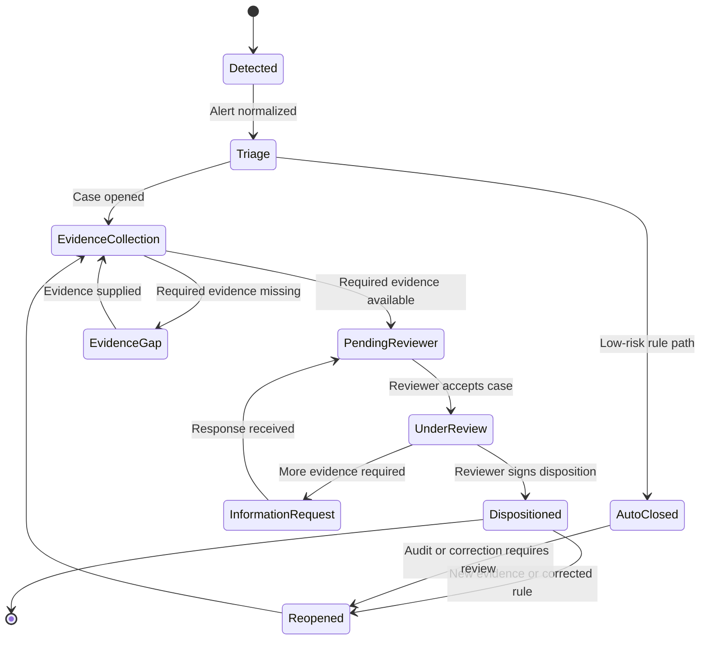

# Case Lifecycle



## States

| State | Meaning | Owner | Exit |
|---|---|---|---|
| `Detected` | Raw alert received | System | Normalized and triaged |
| `Triage` | Determine review need | System | Case opened, auto-closed, or exception |
| `EvidenceCollection` | Gather and link evidence | System / integration | Evidence available or gap identified |
| `EvidenceGap` | Missing, unreadable, or ambiguous evidence | QA / data operations | Gap resolved or exception approved |
| `PendingReviewer` | Ready for review | Reviewer queue | Reviewer accepts |
| `UnderReview` | Reviewer assessing | Reviewer | Decision, request, or reassignment |
| `InformationRequest` | Additional evidence needed | Requester / reviewer | Response received or escalation |
| `Dispositioned` | Human signed outcome | QA / reviewer | Closed or reopened |
| `Reopened` | Requires further work | QA / platform | New adjudication attempt completed |
| `AutoClosed` | Closed by rules | System | Reopened by audit or correction |

## Waiting logic

| Wait type | Trigger | Clock behavior | Action |
|---|---|---|---|
| Reviewer queue wait | No reviewer accepted | Clock continues | Aging report, reassignment, escalation |
| Evidence wait | Missing document/response | Clock continues | Reminder, owner escalation |
| External system wait | Source unavailable | Clock continues | Retry with backoff, degraded capture |
| Approval wait | Awaiting reviewer | Clock continues | Escalation based on remaining time |
| Reopened-case wait | New evidence or corrected rule pending | New attempt tracked separately | Link prior case |

## Manual steps

- Reviewer accepts or reassigns case.
- Reviewer requests additional evidence.
- Reviewer confirms ambiguous identity.
- Reviewer overrides recommendation.
- Reviewer records override reason where available.
- Reviewer signs disposition.
- QA or platform resolves evidence gap.
- Authorized user reopens case.

## Regulatory clock

```text
notification_due_at = alert_ts_utc + reg_window_hours
```

A case may be notified within window but adjudicated weeks later. Notification status and disposition status are tracked independently.
