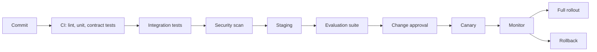

# Versioning and Deployment

## Versioning

| Artifact | Versioning approach | Why |
|---|---|---|
| Case event | Immutable schema version | Replay and reconstruction |
| Canonical entity | Bitemporal record | Business-effective and correction history |
| Specification / SOP | Effective-dated revision | Determines applicable rule at case time |
| Deterministic rule | Semantic version + bundle ID | Reproducible decisions |
| AI model | Model ID, version, provider, snapshot | Evaluation and rollback |
| Prompt | Content-addressed version | Prevents silent behavior change |
| Reference data | Snapshot ID and extraction timestamp | Reproducible resolution |
| Workflow definition | Versioned state machine | Unambiguous lifecycle |
| API contract | OpenAPI version | Protects integrations |

## Decision reproducibility

Store case ID, adjudication attempt ID, evidence hashes, resolved entities, rule version, model and prompt versions, assistant output, guardrail result, reviewer decision, override reason, and release version.

## Deployment pipeline

## Controls

- Backward-compatible database migrations.
- Versioned rule and reference-data bundles.
- Evaluated prompts and models before release.
- Feature flags for assistant participation and auto-triage.
- Canary rollout.
- Rollback of rule bundle, model config, prompt version, and application release.
- Post-deploy verification of ingestion lag, clock calculations, audit writes, evidence linkage, and assistant failure rate.
